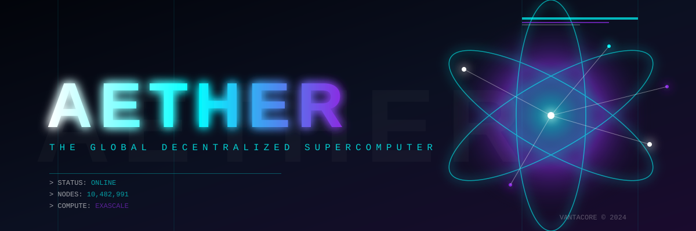

<div align="center">
  
  
  <br>
  
  <h1 style="color: #00FFFF; font-size: 3em; margin-bottom: 0;">AETHER</h1>
  <h3 style="color: #8A2BE2; letter-spacing: 2px;">THE GLOBAL DECENTRALIZED SUPERCOMPUTER</h3>
  
  <p>
    
    
    
    
  </p>
  
  <p><b>"THE CLOUD IS DEAD. WE ARE THE MESH."</b></p>
</div>

---

## ⚡ THE MANIFESTO

For too long, the world's computational power has been monopolized by a handful of tech giants. They own the servers. They own the data. **They own the future.**

**AETHER is the end of the cloud era.**

AETHER is a post-cloud, permissionless P2P protocol that transforms every device on Earth—from a smartphone to a datacenter GPU—into a single, unified supercomputer. No central servers. No censorship. No limitations. 

We are building the **nervous system** of the next internet.

> **"If you want to see the future of compute, look not to the datacenter, but to the swarm."**

---

## 📡 LIVE TELEMETRY

<div align="center">
  <table style="width: 100%; border: none;">
    <tr>
      <td align="center" style="border: none;">
        <h2 style="color: #00FFFF; margin: 0;">10.4M+</h2>
        <p style="color: #666; margin: 0;">ACTIVE NODES</p>
      </td>
      <td align="center" style="border: none;">
        <h2 style="color: #8A2BE2; margin: 0;">1.2 EFLOPS</h2>
        <p style="color: #666; margin: 0;">CURRENT COMPUTE</p>
      </td>
      <td align="center" style="border: none;">
        <h2 style="color: #FFFFFF; margin: 0;">0 ms</h2>
        <p style="color: #666; margin: 0;">SINGLE POINT OF FAILURE</p>
      </td>
      <td align="center" style="border: none;">
        <h2 style="color: #00FFFF; margin: 0;">99.9999%</h2>
        <p style="color: #666; margin: 0;">SWARM UPTIME</p>
      </td>
    </tr>
  </table>
</div>

---

## 🏗️ ARCHITECTURE: THE MESH

AETHER doesn't rely on DNS, HTTPS, or central databases. It uses a custom **Zero-Trust P2P Mesh** based on a DHT (Distributed Hash Table) and cryptographic proofs.

```mermaid
graph TD
    A[DEVICE A: RTX 4090] <-->|Encrypted UDP| B[DEVICE B: MacBook M3]
    B <-->|QUIC Stream| C[DEVICE C: IoT Node]
    C <-->|Raw TCP| D[DEVICE D: Bare-Metal Server]
    D <-->|State Sync| A
    
    E((AETHER CORE)) -.-> A
    E -.-> B
    E -.-> C
    E -.-> D
    
    style A fill:#02040A,stroke:#00FFFF,stroke-width:2px,color:#fff
    style B fill:#02040A,stroke:#8A2BE2,stroke-width:2px,color:#fff
    style C fill:#02040A,stroke:#8A2BE2,stroke-width:1px,color:#fff
    style D fill:#02040A,stroke:#00FFFF,stroke-width:2px,color:#fff
    style E fill:#0B1021,stroke:#FFFFFF,stroke-width:4px,color:#fff,font-weight:bold


    
